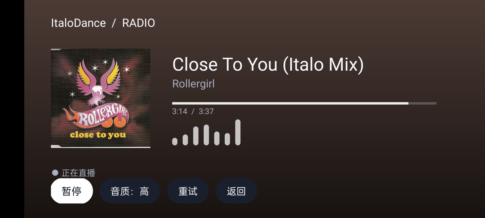

# 映匣 TV · Android ARM32

**为小米电视、Android TV 和 ARM32 电视盒子打造的原生影音应用。** 横屏大屏布局、方向键焦点导航和遥控器播放操作，基于 [tvbox-silicon / 映匣](https://github.com/jo32/tvbox-silicon) 移植，使用 Java、QuickJS 与 AndroidX Media3。

当前版本：`1.8.15-android.4-tv`。最低 Android 5.0 / API 21。电视安装包仅包含 `armeabi-v7a` 原生库。

## 电视上能做什么

- **电影与电视剧**：片库、分类筛选、分页、全局搜索、详情选集、续播、历史和收藏。
- **遥控器播放**：暂停、跳转、选集、清晰度、音轨和字幕、倍速、画面比例、跳过片头片尾。
- **电视直播**：M3U / TXT / TVBox 直播订阅，频道分组和换台。
- **音乐与电台**：GD／网易云、QQ、酷我、咪咕音乐；独立音乐播放页、封面背景、同步歌词、歌单队列与实际音质显示；内置 **ItaloDance Radio**，高／低音质切换、实时歌名与歌手、专辑封面背景、歌曲进度和断流切线。
- **离线下载**：下载队列、本地缓存和离线读取。
- **手机辅助输入**：同一网络下通过手机输入订阅地址，支持备份导入导出。

不提供漫画、网盘和媒体服务器功能。未适配或已确认不可用的源会隐藏，原始订阅和历史数据仍保留。

## 默认订阅与内置电台

首次安装已内置饭太硬订阅地址及配置快照，**不用下载配置文件，也不用手动填写地址**：

```text
https://raw.githubusercontent.com/qist/tvbox/master/fty.json
```

在「设置」可以刷新、添加或移除订阅。升级不会覆盖已有订阅，主动移除默认订阅后也不会自动加回来。播放仍需联网，内容由订阅方提供。

ItaloDance 不依赖影视订阅，入口为「音乐 → ItaloDance 电台」或「直播 → 内置电台」。电台采用 ItaloSound 的公开直播流与正在播放接口，展示逻辑参考同作者 Mp4Hub 的 ARM32 TV 实现；退出页面即停止播放。



### 当前“不卡”源验证

| 源 | 当前状态 |
|---|---|
| 光影 | 手机验证正片总时长、连续播放 35 秒及跳至两分钟后继续解码 |
| 瓜子 | 修复 User-Agent 被覆盖导致只有约 20 秒短片的问题；剧集第 1、2 集及电影正片验证通过 |
| 比特 | 手机验证正片总时长、连续播放 35 秒及跳至两分钟后继续解码 |
| 立播 | 已有 JS，但当前域名和公布的备用域名返回地区限制；暂时隐藏 |
| 厂长、海绵 | 新插件暂无对应 JS；隐藏并列入二期 |

源脚本可执行不等于所有影片、线路都可播放。当前默认配置的 48 项源中展示 23 项、隐藏 25 项；适配规则对刷新或新导入的配置同样生效。完整范围与后续事项见 [源适配记录](docs/SOURCE_SUPPORT.md)。

## 音乐

「音乐」中可搜索 GD／网易云、QQ、酷我和咪咕。GD／网易云与 QQ 另提供榜单、推荐歌单、新专辑以及歌单／专辑搜索；打开歌单后可连续播放、切换歌曲。

新增 **Musify**：可搜索歌曲、歌手，或粘贴 Musify 歌手页链接浏览歌曲。点按结果播放，长按选择收藏或下载；下载完成后从「下载」离线播放。使用公开音频流，无需配置账号，音质以站点原始文件和实际解码结果为准。接入范围与验证见 [Musify 适配记录](docs/MUSIFY.md)。

音乐播放器参考原版 tvOS 的封面、取色模糊背景和同步歌词布局，用 Android 原生视图与 Media3 重新实现；Apple 的 SwiftUI／AVKit 控件没有直接迁入，也未逐像素复刻。点歌曲进入独立播放器，左上角「返回」回到原搜索列表。支持遥控器暂停、上一首／下一首、进度调整、歌词开关、音质切换及收藏。

“优先 FLAC／320／128”是请求音质；状态栏根据实际解码结果显示格式、码率和降级情况。某个平台音源不可用时，按原版逻辑寻找其他平台的同一录音，并注明实际音源。移植范围、音质实测和测试方法见 [音乐适配记录](docs/MUSIC_PORT.md)。

## 安装到电视

从源码构建后，电视包位于 **`artifacts/yingxia-tv-arm32.apk`**。将其复制到 U 盘，在电视文件管理器中打开安装；也可以使用 ADB：

```sh
adb connect 电视IP:5555
adb install -r artifacts/yingxia-tv-arm32.apk
```

打开电视桌面上的「映匣」。应用注册了 Android TV 桌面入口，不要求触摸屏。

| 遥控操作 | 功能 |
|---|---|
| 方向键 | 在侧栏、海报、选集和按钮间移动焦点 |
| 确定键 | 打开内容、执行按钮或显示播放控制 |
| 长按确定键 | 置顶／隐藏源、管理收藏或下载剧集等菜单 |
| 返回键 | 返回上一页、侧栏或退出播放器 |
| 电台播放／暂停键 | 播放或暂停直播音频 |

> 当前已在 realme RMX3350 / Android 13 手机上验证，之前也完成 ARM64 Android TV 模拟器检查。ARM32 库已通过编译、签名和 ELF 检查，尚未在 ARM32 小米电视实机验证。实际视频编码支持取决于电视硬件解码器。

## 构建电视 APK

需要 JDK 17+、Android SDK 34、Build Tools 34.0.0、NDK 28.2.13676358、CMake 3.22.1 和 Python 3。QuickJS 与源脚本已包含在本仓库，不需要额外克隆 Apple 项目。

```sh
git clone https://github.com/cxapython/tvbox-arm.git
cd tvbox-arm
# 在 local.properties 中设置 sdk.dir=/你的/Android/sdk
export ANDROID_HOME=/你的/Android/sdk

# 首次构建时生成本机 Android 开发签名
./gradlew assembleDebug
# 单元测试、Lint、ARM32 release 构建、签名和 ABI 校验
./scripts/build-arm32.sh
```

输出：`artifacts/yingxia-tv-arm32.apk`，校验和：`artifacts/SHA256SUMS`。默认使用本机 Android 开发签名，自用覆盖升级请保留同一份签名。构建不会自动修改或拉取上游源码，移植基线记录在 [SOURCE_REVISION](docs/SOURCE_REVISION)。

### GitHub 自动打包

推送到 `main`、推送 `v*` 标签、向 `main` 提交 PR，或在 GitHub Actions 手动运行 **Build ARM32 APK**，均会自动执行单元测试、Lint、ARM32 release 构建、签名及 ELF 校验。

在仓库 **Actions → Build ARM32 APK → 对应运行 → Artifacts** 下载 `yingxia-tv-arm32-提交SHA`，解压得到 `yingxia-tv-arm32.apk` 和 `SHA256SUMS`。APK 保存 30 天，测试报告保存 14 天。

无需配置即可构建安装包。默认使用本次运行临时生成的开发签名；不同运行及本地构建的签名可能不同，不能保证覆盖安装。需要固定签名以保留数据覆盖升级时，在仓库 **Settings → Secrets and variables → Actions** 配置：

| Secret | 内容 |
| --- | --- |
| `ANDROID_KEYSTORE_BASE64` | 现有签名 keystore 的 Base64 内容 |
| `ANDROID_KEY_ALIAS` | 密钥别名；本地默认开发签名为 `androiddebugkey` |
| `ANDROID_STORE_PASSWORD` | keystore 密码；开发签名默认 `android` |
| `ANDROID_KEY_PASSWORD` | 密钥密码；开发签名默认 `android` |

使用与现有安装包相同的 keystore 才能覆盖升级。PR 构建始终使用临时开发签名。签名文件仅在 runner 临时目录中使用，不进入仓库或构建产物。

### 手机验证包

手机测试包额外包含 ARM64。`-Pemulator` 仅用于设备／模拟器验证，电视正式包用上面的 ARM32 构建脚本。

```sh
./gradlew -Pemulator assembleDebug assembleDebugAndroidTest
adb install -r app/build/outputs/apk/debug/app-debug.apk
adb install -r app/build/outputs/apk/androidTest/debug/app-debug-androidTest.apk
adb shell am instrument -w -r \
  -e class com.yingxia.tv.RuntimeIntegrationTest \
  com.yingxia.tv.test/android.test.InstrumentationTestRunner
```

真实电台验证：将测试类改为 `com.yingxia.tv.RadioIntegrationTest`。真实影视源测试位于 `LiveSubscriptionTest`，按需运行单个方法，受站点和网络状态影响；不要把只返回地址或只播放短片当作正片成功。

## 项目结构

| 目录 | 内容 |
|---|---|
| `app/src/main/java/com/yingxia/tv/ui` | 电视主界面、视频播放器、独立电台页面 |
| `app/src/main/java/com/yingxia/tv/core` | 订阅、片库、源支持规则、播放和电台数据模型 |
| `app/src/main/java/com/yingxia/tv/data` | 网络、存储、源引擎、缓存和下载 |
| `app/src/main/assets/scripts` | TVCore 迁入的源 JS 与 QuickJS 宿主环境 |
| `app/src/main/assets/default-subscription.json` | 默认订阅快照 |
| `app/src/main/assets/source-support.json` | 暂缓显示的源脚本及原因 |
| `vendor/QuickJS`、`app/src/main/cpp` | QuickJS 引擎及 Android JNI |
| `docs` | 验证记录、功能对照和二期清单 |

## 文档与许可

- [本版验证记录](docs/TV_RELEASE_REPORT.md)
- [瓜子 20 秒短片修复](docs/GUAZI_PLAYBACK_FIX.md)
- [源适配与二期清单](docs/SOURCE_SUPPORT.md)
- [与原版的功能对照](docs/PARITY.md)

沿用原版 **GPL-3.0-only**，见 [LICENSE](LICENSE)；第三方组件和移植来源见 [THIRD_PARTY_NOTICES.md](THIRD_PARTY_NOTICES.md)。
