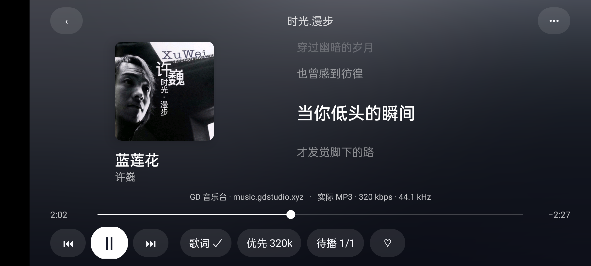
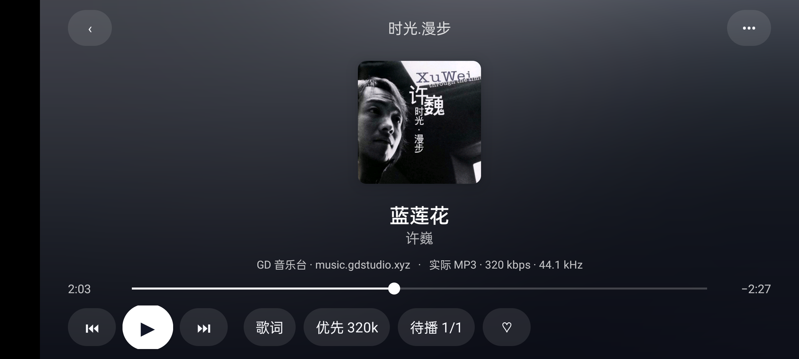

# 音乐平台与独立播放器移植

移植基线：`tvbox-silicon` / `030330f67eda8edf8f29e6611c1cb9ed03734f85`，GPL-3.0-only。Swift 业务逻辑转为 Java；Android TV 使用 Media3 解码和原生遥控器控件。

## 原项目对应关系

| 原项目 | Android |
| --- | --- |
| `App/MusicTVScreen.swift` 的 MusicTVContent / MusicTVSong / MusicTVBackdrop | `ui/MusicPlayerActivity.java`：独立音乐页、封面模糊背景、左右封面／歌词、居中封面模式、暂停缩放 |
| `MusicPlayerViews.swift`、`MusicQueue.swift` | 音乐专用进度条、上一首／下一首、播放／暂停、歌单队列、3 秒内上一首／超过 3 秒重新开始、收藏、下载、音质与歌词同步 |
| `MusicCatalog.swift` 的 NeteaseMusicCatalog、GDStudioProvider | `core/GdMusicCatalog.java`：GD 搜索、音质参数、网易云批量时长／封面 |
| `MusicNeteaseCollections.swift`、`MusicBrowse.swift` | GD／网易云榜单、推荐歌单、新碟、歌单／专辑搜索和详情；长歌单按 200 首补全，最多 500 首，维持原顺序 |
| QQMusicCatalog、`MusicCollectionCatalogs.swift`、MusicBrowse 的 QQ 部分 | `core/NativeMusicCatalog.java`：QQ 自有移动搜索、榜单、歌单、专辑、歌词 |
| `MusicMiguKuwo.swift` | 咪咕自有搜索及双 ID、酷我自有搜索；使用原项目的咪咕播放器协议和音质文件探测 |
| NianxinProvider、XinghaiProvider、VKeysProvider | `data/MusicClient.java`：酷我念心／星海，QQ VKeys，网易云 GD／念心／星海，已安装 LX 音源 |
| MusicResolution 的 companion catalogs | 原通道失败后匹配其他平台的同一录音；保留收藏身份、保存实际播放平台与 ID，标明“已切换音源” |
| MusicHealth.admit | `MusicRequestBudget.java`：GD 50 次／5 分钟、星海 30 次／5 分钟，跨请求与客户端实例共享并保存；VKeys 风控冷却 10 分钟 |

所有点播音乐入口，包括收藏、历史和离线下载，统一进入独立 `MusicPlayerActivity`。影视继续使用 `PlayerActivity`。歌单内点歌携带整份队列，换页不会截断队列；单首搜索结果按单曲播放。离开播放器暂停，退出释放解码器。

原版只为 QQ 和网易云提供上述推荐与歌单接口；酷我、咪咕此次按原版接入歌曲搜索与播放，不添加没有实现的歌单入口。原有酷狗 GD 接口保留。需要用户提供密钥的可选 HYW 音源没有自动启用。

跨平台匹配比原版更保守：完整歌名（保留 Live／Remix 等版本标记）、歌手一致，且时长差不超过 3 秒，才允许替换音源或借用另一平台的歌词。无法匹配时明确失败，不以另一位歌手的翻唱替代。

## 音质显示

选择器显示“优先音质”，代表请求参数；播放器状态显示解码器／提取器实际读到的格式、码率和采样率。没有读出码率时显示“码率待确认”，不拿接口声明或文件后缀代替测量。请求 FLAC 却得到有损音频、请求 320 却返回明显较低码率时显示“已降级”。FLAC 编码本身不能证明上游母带没有经过有损转码。

2026-11-10 对 GD《蓝莲花》/ 许巍 / `168091` 的独立 ffprobe 结果：

| 请求 | 实际编码 | 实际码率 | 采样率／位深 | 时长 |
| --- | --- | --- | --- | --- |
| 128 | MP3 | 128000 bit/s | 44.1 kHz | 270.524 秒 |
| 320 | MP3 | 320000 bit/s | 44.1 kHz | 270.524 秒 |
| FLAC / br=999 | FLAC | 文件平均约 927890 bit/s | 44.1 kHz／16-bit | 270.524 秒 |

原始探测结果：`artifacts/gd-audio-probe.json`。

## 验证

最终构建通过 185 项单元测试、`lintDebug`、release 签名和 ARM32 ELF 校验。安装包为 `artifacts/yingxia-tv-arm32.apk`（约 6.8 MB）。

自动回归覆盖 GD 请求窗口、错误响应、歌曲模型、新旧元数据字段、长歌单补全及顺序、翻译歌词，QQ 移动搜索请求、专辑分页、防重复、咪咕双 ID、酷我文本实体，以及实际音质和跨平台录音匹配。

2026-11-10 实机结果（《蓝莲花》）：

| 平台 | 实际音源 | 解码 | 时长 | 两分钟跳转 |
| --- | --- | --- | --- | --- |
| GD／网易云 | GD Studio | MP3 128／320、FLAC 三档 | 约 270.5 秒 | 全部通过 |
| QQ | VKeys | FLAC | 270.547 秒 | 通过 |
| 酷我 | 星海（念心失败后切换） | FLAC | 270.547 秒 | 通过 |
| 咪咕 | 咪咕自身音源 | FLAC | 269.946 秒 | 通过 |

QQ VKeys 曾返回上游账号风控，后续测试恢复；不保证该第三方服务持续可用。另单独模拟其冷却状态，验证 QQ 歌曲成功匹配咪咕录音，保持原收藏 ID 并标注换源。

GD 与 QQ 均验证了 4 类推荐栏目、榜单详情、歌单与专辑搜索和详情。播放器验证了遥控器上一首／下一首、暂停状态切换至 FLAC 后位置仍在 60 秒且不自动播放、收藏切换及退出释放。





手机验证设备为 realme RMX3350 / Android 13；ARM32 电视包另做构建、签名和 ELF 校验。尚未新增 ARM32 电视实机验证。

运行真实接口及音频测试：

```sh
./gradlew -Pemulator assembleDebug assembleDebugAndroidTest
adb install -r app/build/outputs/apk/debug/app-debug.apk
adb install -r app/build/outputs/apk/androidTest/debug/app-debug-androidTest.apk
adb shell am instrument -w -r \
  -e class com.yingxia.tv.GdMusicIntegrationTest,com.yingxia.tv.NativeMusicIntegrationTest,com.yingxia.tv.MusicPlayerIntegrationTest \
  com.yingxia.tv.test/android.test.InstrumentationTestRunner
```

这些在线测试依赖公共站点状态，不属于默认单元测试。它们检查真实解码、正曲时长和跳至两分钟后继续播放，不把“拿到地址”当作播放成功。设备结果分别保存为 `gd-music-live-report.json`、`native-music-live-report.json`、`music-player-controls-report.json`。
